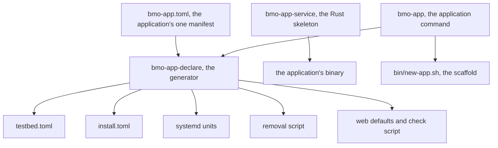

# What this base carries

- **One application, one manifest.** Every BMO application declares itself once, in a
  `bmo-app.toml` at its root, and the rest of its declarations are generated readings of it
  (`docs/manifest.md`). The manifest holds only what differs per application: its name, its
  ports, its roots, its prefix, its web half, its person's values, its skills and memories.
- **The mechanism stands here; the policy stands in the application.** This repository holds
  the generator, the service skeleton, the web defaults, and the install and removal paths.
  An application holds its domain: its routes and stores, its schema, its words and images,
  its design decisions, and its machine facts (the proxy, DNS and firewall rows of its own
  deploy document).
- **The formats are the platform's.** The generator writes the testbed's declaration format
  and the install declaration format as the testbed's own documents state them; it invents no
  parallel schema. The manifest's own file is this repository's reading, like any project's
  syntax.
- **A base never knows its consumers.** Nothing here names an application; the generator runs
  inside an application's checkout on that checkout's manifest, the skeleton serves whatever
  router is handed to it, and the application command finds applications in the machine's
  checkout register as it runs and names none of them.
- **Reuse travels as generated files, not as runtime reads across checkouts.** A release's
  build tree and a placed bench may hold no sibling checkout at the moment a web build runs,
  so every file the generator hands out stands complete inside the application: the
  declarations, the unit files, the check script, the defaults module. The only live path
  dependency is the Rust crate, which the testbed lays by name from the machine's checkout
  register.

## The pieces

| Piece | What it is |
|---|---|
| `crates/declare` | The generator binary `bmo-app-declare`: reads a manifest, writes or checks its readings; its library holds the manifest's model, the readings' read, check and write, and one renderer a reading — the testbed declaration, the install declaration, the systemd units, the web scaffold's defaults and the removal script — each a module of its own |
| `crates/service` | The library `bmo-app-service`: the JSON answer envelope, the serving loop and its graceful stop, the health verb's checks (`docs/service.md`) |
| `crates/app` | The unit command `bmo-app`: the `bmo app` verbs that front the scaffold and the generator from one place (`docs/app-command.md`) |
| `templates/` | The text every application's units, removal script, web check and web defaults are made of |
| `bin/` | The scaffold that stands a new application up, and the generator build (`README.md`) |

## What stays each application's own

- Its Cargo and package manifests beyond the path to this base, its routes, stores and schema.
- Its console bundle under `client/` and the app declaration its deployment publishes, where
  its screen is the console's.
- Its Korean: every string a person reads, in its locale files.
- Its ports and roots as values: the manifest names them; the unit and install readings are
  written from the manifest, never from a central table.
- Its docs: its design, its API, its machine table.
- Its console screen, where it brings one: that contract belongs to the platform's UI base,
  not here.

## Boundaries

- Each crate stands on registry crates alone.
- The generator writes text and imports nothing from the library; the two share only the
  manifest's meaning, which this document states.
- This repository installs no service and deploys none of its own: like every base library,
  it is cloned by its consumers and built inside their builds. What it deploys is the one
  command it lends the machine, linked beside the entry command (`docs/app-command.md`).
